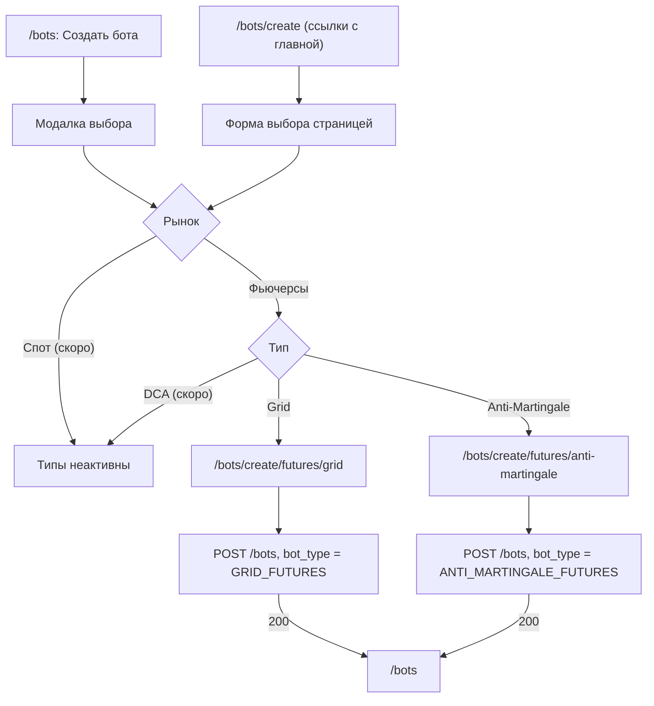

# Создание бота

Кнопка «Создать бота» на `/bots` (и «Создать первого бота» в пустом списке) открывает модалку выбора: сначала рынок, ниже тип бота, затем «Продолжить» ведёт на страницу этого типа.
`/bots/create` — та же форма выбора страницей. На неё ведут ссылки с главной, поэтому адрес остаётся рабочим.

## Потоки

## Каталог типов

Все типы описаны в `app/utils/botCatalog.ts`: рынок, сегмент URL, `bot_type`, иконка, ключи перевода, флаг `available`.
Модалка и страница выбора строятся только из каталога. Тип с `available: false` показывается с меткой «Скоро» и не кликается: бэкенд пока принимает только `GRID_FUTURES` и `ANTI_MARTINGALE_FUTURES`.
Рынок, у которого нет ни одного доступного типа, тоже помечен «Скоро», но выбрать его можно, чтобы увидеть список.

### Как добавить тип

1. Запись в `BOT_CATALOG` с `available: true`.
2. Страница `app/pages/bots/create/<market>/<slug>.vue` по образцу `futures/anti-martingale.vue`: `useBotCreatePage(<bot_type>, …)` + `BotCreatePageShell` + своя форма + `BotCreationHistory`.
3. Форма `Bot<Тип>Form.vue` на `BotCreateFormShell` (API-ключ, пара, ошибки, кнопка) и `useBotCreateSubmit` (базовые проверки, `POST /bots`, предупреждение движка, переход на `/bots`). Наружу отдаёт `applyPayload` и `scrollIntoView`.
4. Ключи перевода `bots.catalog_*` в `ru.json` и `en.json`.

## Страницы типов

| Адрес | Тип | Что на странице |
|-------|-----|-----------------|
| `/bots/create/futures/grid` | `GRID_FUTURES` | `BotGridFuturesForm`: обычный размер или смешанная сетка, TP, SL; справа `BotLiquidationCheck` (тип в запросе всегда `GRID_FUTURES`, выбора типа в панели больше нет) |
| `/bots/create/futures/anti-martingale` | `ANTI_MARTINGALE_FUTURES` | `BotAntiMartingaleForm`: уровни входа и доп. настройки; проверка, что на этой паре нет другого активного анти-мартингейл бота |

Без API-ключей вместо формы показывается карточка «Добавьте API-ключ…» со ссылкой в настройки.
Адрес несуществующего типа (например `/bots/create/spot/grid`) отдаёт 404.

## История создания

`GET /bots/creation-history` не умеет фильтровать по типу, поэтому страница берёт до 100 записей и оставляет только свой тип.
Записи без `bot_type` (созданные до появления поля) считаются `GRID_FUTURES`.
«Скопировать настройки» заполняет форму на той же странице; запись другого типа форма не примет.

## Ошибки

Grid: ошибки размера, смешанной сетки, TP и SL показываются у своих блоков, как раньше (см. `order-size.md`, `take-profit.md`, `stop-loss.md`).
Anti-Martingale: ошибка сервера показывается общим алертом формы. Раньше она могла попасть в скрытые поля TP / SL / размера, которых у этого типа нет, и пропасть.

## Файлы

| Что | Где |
|-----|-----|
| Каталог типов | `app/utils/botCatalog.ts` |
| Выбор рынка и типа | `app/components/BotTypePicker.vue`, `app/composables/useBotTypePicker.ts` |
| Модалка на `/bots` | `app/components/BotCreateModal.vue` |
| Страница выбора | `app/pages/bots/create/index.vue` |
| Каркас страницы типа | `app/components/BotCreatePageShell.vue`, `app/composables/useBotCreatePage.ts` |
| Каркас формы | `app/components/BotCreateFormShell.vue`, `app/composables/useBotCreateSubmit.ts` |
| Grid Futures | `app/pages/bots/create/futures/grid.vue`, `app/components/BotGridFuturesForm.vue` |
| Anti-Martingale Futures | `app/pages/bots/create/futures/anti-martingale.vue`, `app/components/BotAntiMartingaleForm.vue` |
