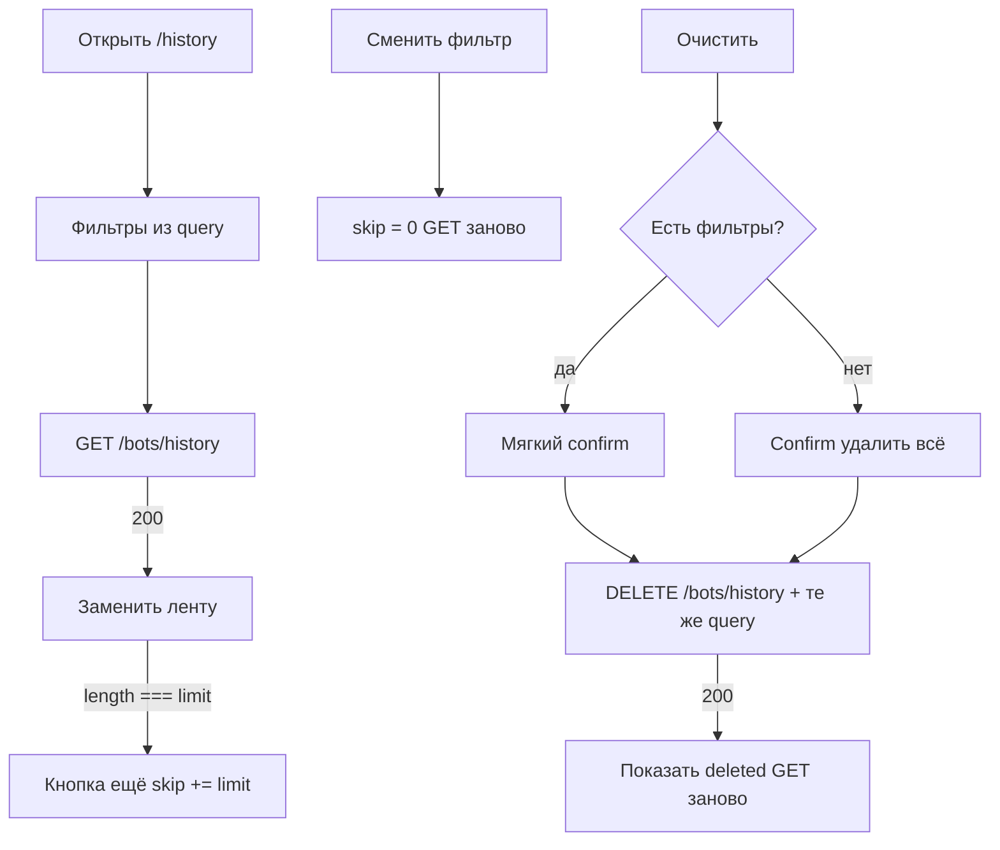

# История ботов

Страница: `/history` (редирект с `/bots/history`).  
Пункт «История» в меню «⋯» карточки на `/bots` и кнопка в шапке `/bots/:id` ведут на `/history?bot_id=`. На странице бота есть свой блок последних событий (та же лента, см. [`list-and-detail.md`](./list-and-detail.md)).

Журнал событий **живых ботов**: старт, стоп, закрытие, пересбор сетки, исполнение ордера, циклы anti-martingale и смешанной сетки.  
Один бот — много строк. Всегда только события текущего пользователя.  
После stop-loss бот скрывается из списка, но лента `?bot_id=` остаётся доступна.

Это **не** журнал попыток создания (`GET /bots/creation-history` на страницах `/bots/create/<рынок>/<тип>`).  
Это **не** WebSocket: WS обновляет список ботов, история в канал не пушится.

## Потоки

## API

| Метод | Путь | Назначение |
|-------|------|------------|
| GET | `/bots/history` | лента событий |
| DELETE | `/bots/history` | удалить события (не ботов и не ордера) |

Query у GET и DELETE одинаковые, кроме пагинации (`skip` / `limit` только у GET).

| Параметр | Смысл |
|----------|--------|
| `bot_id` | один бот |
| `created_from` / `created_to` | границы `created_at`, ISO-8601 с таймзоной |
| `exchange` | `BINANCE` \| `BYBIT` \| `OKX` \| `OTHER` |
| `skip` / `limit` | пагинация GET, default `50`, max `500` |

Без фильтров GET — последние события по всем ботам. Без фильтров DELETE — вся история пользователя. Боты в списке не меняются.

## Подписи

| `event_type` | Подпись |
|--------------|---------|
| `created` | Бот запущен |
| `stopped` | Бот остановлен |
| `close_completed` + `reason: take_profit` или `source: auto` (и не `stop_loss`) | Бот закрыт по take-profit |
| `close_completed` + `reason: stop_loss` | Бот закрыт по stop-loss |
| `close_completed` иначе | Бот закрыт |
| `grid_redeployed` | Сетка перевыставлена вручную |
| `grid_recreated` | Сетка перевыставлена автоматически (после take-profit при `auto_restart`; после stop-loss не бывает) |
| `take_profit_filled` | Take-profit исполнен |
| `stop_loss_filled` | Stop-loss исполнен |
| `order_filled` + `kind: entry` | Вход исполнен |
| `order_filled` + `kind: order`, `client_order_id` на `o0` | Вход исполнен (anti-martingale, вход на пробое) |
| `order_filled` + `kind: order`, `client_order_id` на `o{n}`, `n ≥ 1` | Доливка исполнена |
| `order_filled` + `kind: order`, номер не распознан | Ордер исполнен |
| `order_filled` + `kind: addon` | Доливка исполнена |
| `order_filled` иначе (`kind: grid`) | Ордер сетки исполнен |
| `exit_order_filled` | Trailing stop исполнен |
| `cycle_started` | Цикл открыт |
| `addon_placed` | Доливка выставлена |
| `addon_rejected` | Доливка отклонена |
| `entry_rejected` | Вход отклонён |
| `cycle_closed` | Цикл закрыт |
| `grid_cycle_started` | Цикл сетки начат |
| `grid_cycle_settled` | Депозит пересчитан после цикла |
| `grid_size_resolved` | Размер входа рассчитан от баланса |
| `config_updated` | Конфиг обновлён |
| `removed_from_tracking` + `reason: stop_loss` | Убран из отслеживания по stop-loss |
| `removed_from_tracking` иначе | Убран из отслеживания |
| `error` | Ошибка бота |
| неизвестный | сырой `event_type` |

`client_order_id` anti-martingale: `b{id}v{ver}o{n}`, `n = 0` — вход, `n ≥ 1` — доливка №n (`antiMartingaleLegIndex`). У сетки `b{id}v{ver}{e|g}{n}`, у выхода `b{id}v{ver}x{gen}`.

В строке ленты: `created_at`, подпись, `symbol` и `exchange` из события (не из store бота), под ними детали из `payload`.  
`compact` убирает строку `#bot_id` / `symbol` / биржа (лента одного бота).

## Детали события

Чипы «подпись значение» под заголовком собирает `botEventDetails` (`app/utils/botEventDetails.ts`). Числа в `payload` — строки или `null`; пустые поля пропускаются. Формат — `app/utils/formatNumber.ts`: цены `formatPrice`, USDT `formatUsdt` (суммы округляются до центов до выбора знака и цвета, поэтому «−0,00» не бывает), объём `formatQuantity`. `config_version` не показываем.

| `event_type` | Что видно |
|--------------|-----------|
| `order_filled` | сторона (покупка зелёным, продажа красным; у anti-martingale стороны нет), «Доливка №n» для `o{n}` (и при `kind: order`, и в старых событиях с `kind: addon`), объём, цена `avg_price` (у доливки — «Цена триггера») |
| `exit_order_filled` | объём, «Цена триггера»: движок пишет в `avg_price` цену trailing stop, а не исполнения |
| `cycle_started` | баланс на старте (`cycle_start_balance`), `reason` движка отдельной строкой как есть (англ.) |
| `cycle_closed` | цена выхода «≈» (`exit_price` — триггер trailing stop) |
| `addon_placed` / `addon_rejected` | «Доливка №`order_index`»; у отказа `reason` строкой |
| `entry_rejected` | `reason` строкой |
| `grid_cycle_started` | базовый депозит, номинал сетки, число ордеров |
| `grid_cycle_settled` | итог цикла со знаком и цветом, PnL, комиссии, funding, депозит до → после, начало цикла; при `source: orders_estimate` — «Оценка по ордерам», при `unavailable` — «Данные биржи недоступны» |
| `grid_size_resolved` | сумма входа в USDT и «N % от свободного баланса X USDT» |
| `config_updated` + `applies_from: next_cycle` | «Применится со следующего цикла» |
| `take_profit_filled` | автоперезапуск да / нет |
| `stop_loss_filled` | «Убран из отслеживания» (`auto_restart` после SL не действует, не показываем) |
| `close_completed` вручную (`source: user`, не TP / SL) | «Вручную» |
| `error` | сообщение и поля ошибки отдельным блоком (`parseBotEventMessage`) |

Остальные события без деталей: всё нужное уже в подписи.

## Код

| Часть | Путь |
|-------|------|
| Страница | `app/pages/history.vue` |
| Лента | `app/components/BotEventFeed.vue` |
| Карточка → история | `app/components/BotCard.vue` (меню «⋯»), `app/components/BotDetailHeader.vue` |
| Лента на странице бота | `app/components/BotDetailEvents.vue` |
| API | `app/composables/useBots.ts` (`fetchBotHistory`, `clearBotHistory`) |
| Состояние ленты | `app/composables/useBotEventHistory.ts` |
| Подписи | `app/utils/botEventType.ts` |
| Детали `payload` | `app/utils/botEventDetails.ts` |
| Query / даты | `app/utils/botHistory.ts` |
| Типы | `shared/types/bot.ts` (`BotEventOut`, `BotEventType`, `HistoryClearResult`) |

Take-profit как ордер на бирже: [`take-profit.md`](./take-profit.md).  
Stop-loss как ордер на бирже: [`stop-loss.md`](./stop-loss.md). После SL бот скрывается из списка (`bot_removed`), история `?bot_id=` остаётся.  
Попытки `POST /bots`: экран создания, `GET /bots/creation-history`.
